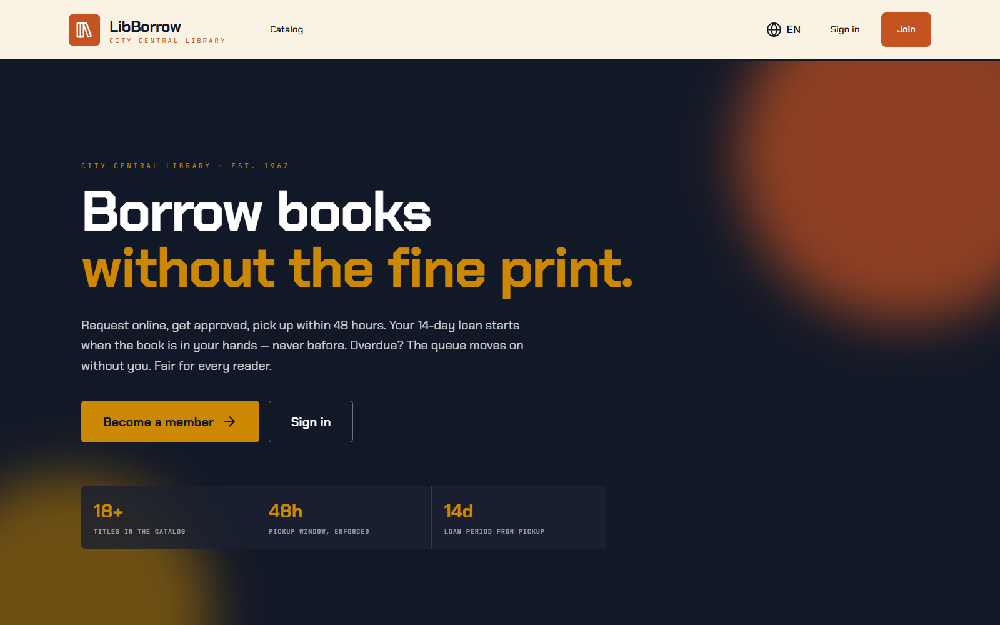
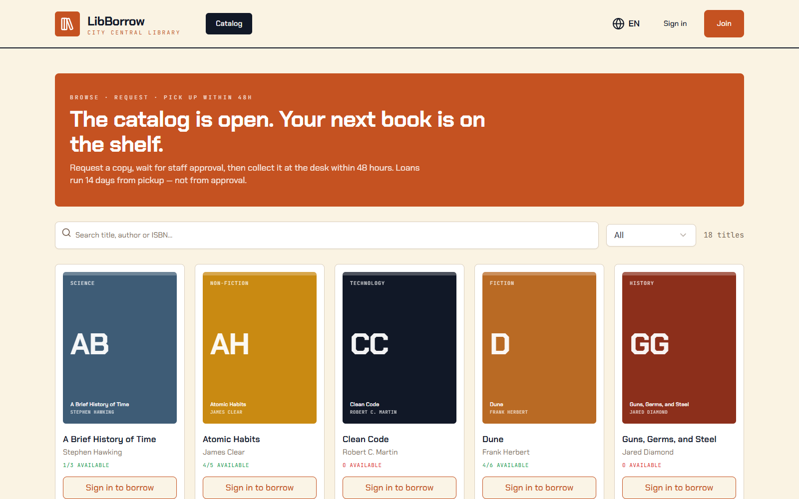
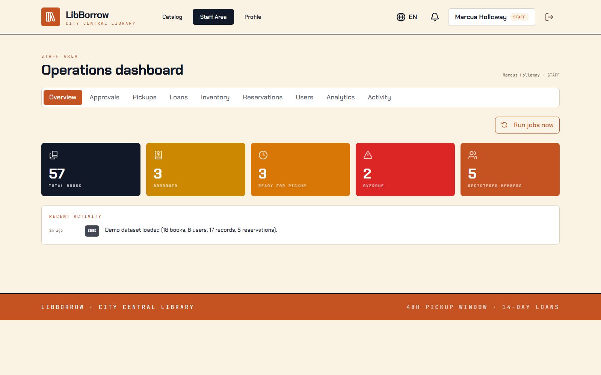
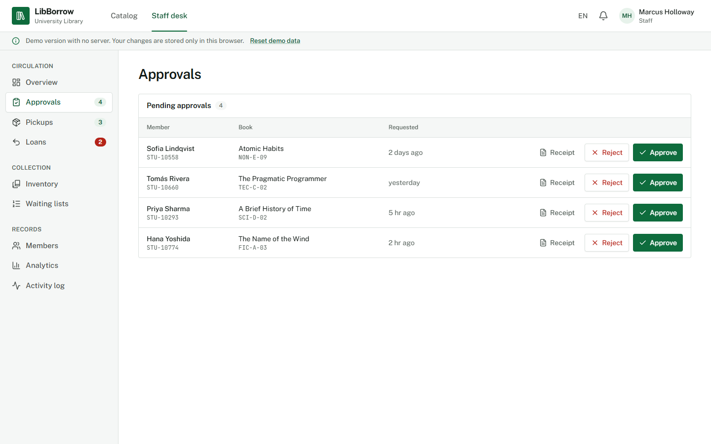
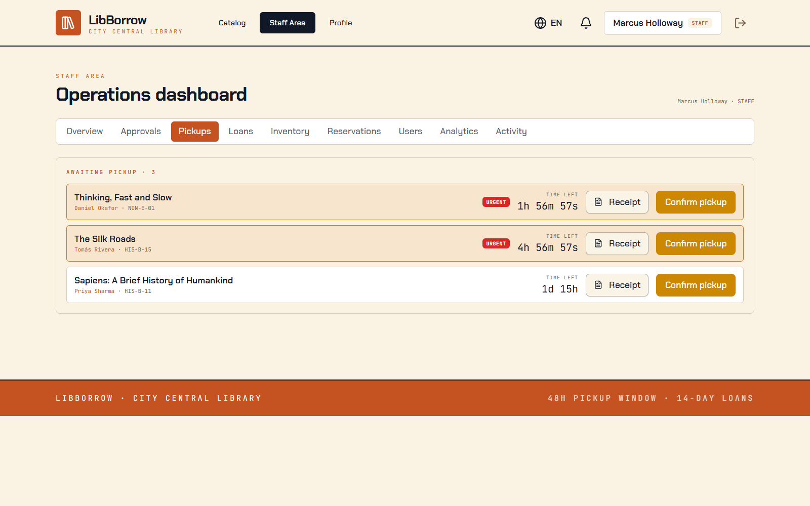
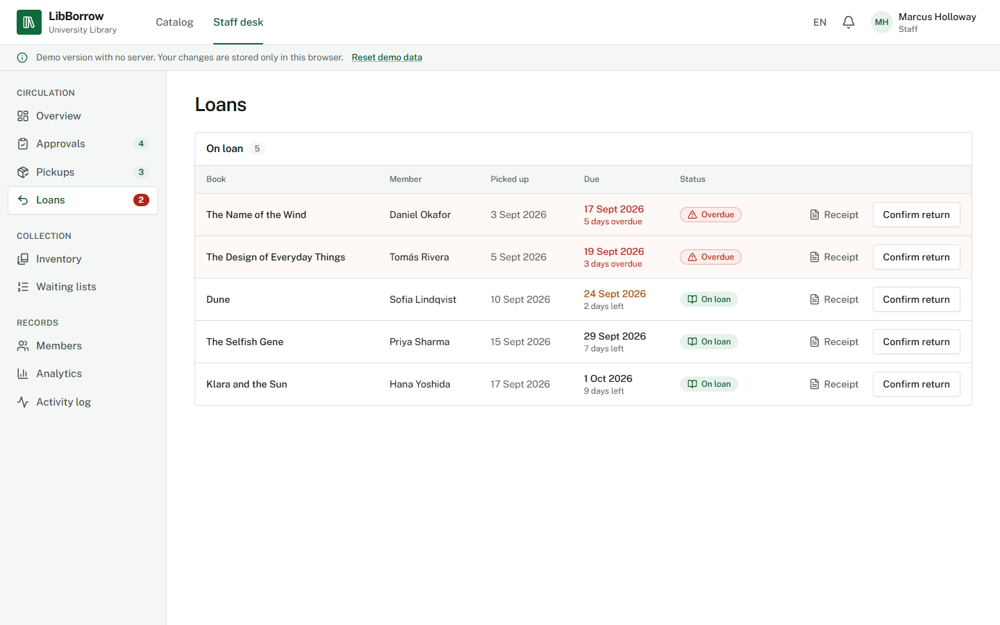
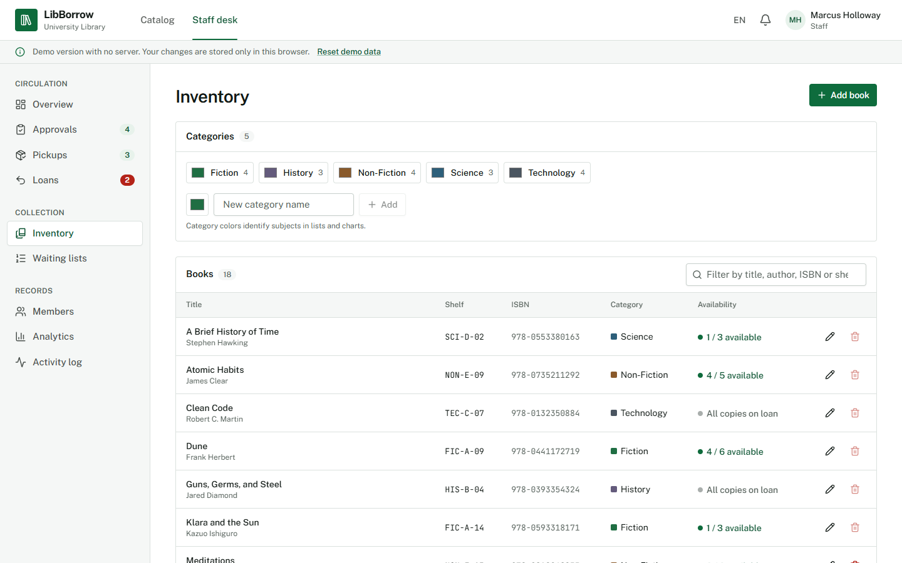
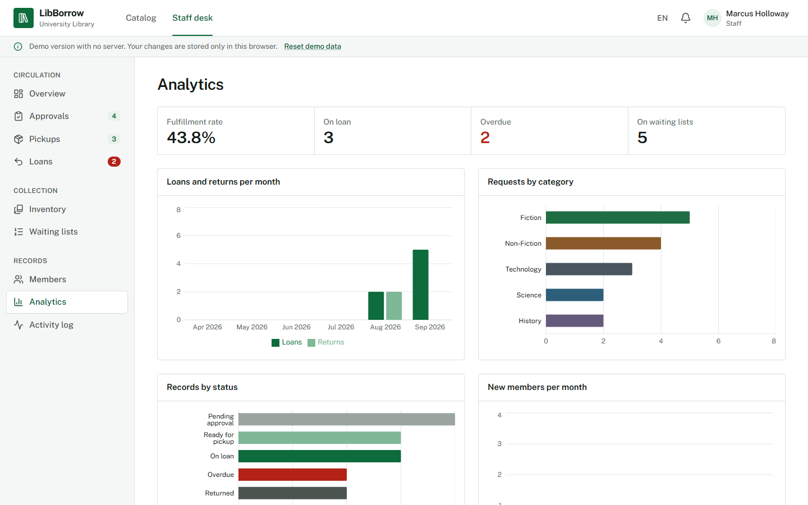

# LibBorrow — Library Borrowing Platform

A full-stack library management system: members browse the catalog and request books;
staff approve requests, confirm pickups and returns on a live operations dashboard.
Built for a university library: a serious, trilingual (French / Arabic / English)
interface in green, white and red. Design system: `DESIGN.md`.

- **Backend:** Django 6 + Django REST Framework + JWT (SimpleJWT), SQLite dev database
  (PostgreSQL-ready), ReportLab + QR digital ID cards, cron-ready management commands.
- **Frontend:** React 19 + TypeScript + Vite + Tailwind CSS + shadcn/ui.

## Screenshots

<table>
<tr><td align="center" width="50%"><br/><sub>Landing</sub></td><td align="center" width="50%"><br/><sub>Catalog</sub></td></tr>
<tr><td align="center" width="50%"><br/><sub>Overview</sub></td><td align="center" width="50%"><br/><sub>Approvals</sub></td></tr>
<tr><td align="center" width="50%"><br/><sub>Pickups</sub></td><td align="center" width="50%"><br/><sub>Loans</sub></td></tr>
<tr><td align="center" width="50%"><br/><sub>Inventory</sub></td><td align="center" width="50%"><br/><sub>Analytics</sub></td></tr>
</table>


## The spine of the system

A loan does **not** start at approval. It starts only when the member physically picks
up the book and staff confirm it. If pickup does not happen within **48 hours** of
approval, the request auto-cancels and the reservation queue hands the slot to the next
member with a fresh 48-hour window. Loans run **14 days from pickup**.

```
PENDING --(staff approves)--> READY --(staff confirms pickup)--> BORROWED --(staff confirms return)--> RETURNED
PENDING --(staff rejects)--> REJECTED
READY --(48h deadline passes)--> CANCELLED --(queue non-empty)--> new READY for next member
BORROWED --(past due date)--> OVERDUE   (blocks new requests until resolved)
```

`available_copies` changes at exactly two moments: **pickup (−1)** and **return (+1)**.
A copy waiting on the hold shelf (a `READY` record) is not free: **free copies** =
`available_copies` minus the book's `READY` records.

- A returned copy serves the reservation queue first: the first active member in the queue
  gets a `READY` hold with a fresh 48-hour window (members deactivated in the meantime are skipped).
- Staff can approve a request only while the book has a free copy; new requests and queue
  joins follow the same count, so a held copy cannot be taken by someone else.
- Deactivating a member blocks sign-in (login, access and refresh tokens) and any new request or reservation.

## Run locally

**Backend** (port 8000):

```bash
cd backend
python -m venv .venv && .venv/Scripts/activate        # Windows; source .venv/bin/activate on Unix
pip install -r requirements.txt
python manage.py migrate
python manage.py seed_demo                             # optional demo dataset
python manage.py runserver 8000
```

**Frontend** (port 3000, proxies `/api` → 8000):

```bash
npm install
npm run dev
```

**Demo accounts** (password `password123`): `admin@libborrow.dev` ·
`staff@libborrow.dev` · `priya@example.com` (member). Staff self-registration uses
invite code `LIB-STAFF-2024` (env `STAFF_INVITE_CODE`).

**Background jobs** (idempotent; wire to cron/Celery Beat in production):

```bash
python manage.py cancel_expired_pickups   # hourly
python manage.py mark_overdue             # nightly
```

Staff can also trigger both on demand from the staff desk ("Run scheduled checks" →
`POST /api/jobs/run`).

**Tests:** `cd backend && python manage.py test library` — 21 tests covering every
state transition, invalid transitions, stock rules, queue handoff, job idempotency,
permission boundaries (incl. staff-cannot-borrow), receipt access rules, user
management, categories CRUD, analytics and an end-to-end flow.

**Staff registration:** on the sign-up page, tick "I am a member of library staff"
and enter the invite code.

**No-server demo:** `npm run dev:demo` (or the Vercel deployment) runs the whole API
in the browser from `src/api/demo.ts`, with one-click demo accounts on the sign-in page.

## Hosting

See `DEPLOYMENT.md` for a production checklist (env vars, Postgres, static build,
cron schedule). Short version: serve `dist/` from any static host, run Django via
gunicorn/uvicorn behind a reverse proxy, set `DJANGO_SECRET_KEY`, `FRONTEND_URL`,
`CORS_ALLOWED_ORIGINS`, and schedule the two management commands.

## Feature map

| Area | Where |
|---|---|
| Borrow state machine | `backend/library/services.py` (explicit transition table) |
| Role permissions (403s) | `backend/library/permissions.py` + per-view guards; only MEMBER accounts can borrow/reserve |
| Categories (staff-managed, colored) | `backend/library/models.py Category` + `/api/categories` CRUD |
| Bulk book import (Excel / CSV / JSON) | Staff desk → Inventory → Import books (`src/pages/staff/ImportBooksPage.tsx`) → `POST /api/books/import` (dry-run preview, then import); `python manage.py import_books file.xlsx [--update] [--dry-run]`; rules in `backend/library/importing.py` |
| Book cover uploads | `Book.cover_image` → `/media/covers/`; staff editor in the UI |
| Request receipts (REQ-xxx PDF) | `backend/library/documents.py` → `GET /api/borrow-records/<id>/document` (owner or staff) |
| Background jobs | `backend/library/management/commands/` + `services.run_hourly_cancellation / run_nightly_overdue` |
| ID card PDF + QR | `backend/library/idcard.py` → `GET /api/users/me/id-card` |
| Staff QR scan lookup | `GET /api/users/<uuid>/scan` → `/scan/:uuid` page |
| User management | `/api/users` list/detail, admin-only `DELETE /api/users/<id>/delete` |
| Analytics | `GET /api/analytics` → charts page (recharts) |
| API surface | `backend/library/urls.py` |
| Tests | `backend/library/tests.py` — 21 tests |
| Landing page | `src/pages/LandingPage.tsx` (catalog search, borrowing rules, books on the shelf) |
| Login / signup | `src/pages/LoginPage.tsx`, `src/pages/SignupPage.tsx` — staff sign-up requires the invite code |
| i18n (EN / FR / AR with RTL) | `src/i18n/index.tsx` + header switcher |
| Request list | `src/cart/CartContext.tsx` + `/cart` page (students send several requests at once) |
| Staff desk (sidebar, live queue counts) | `src/pages/staff/` — Overview · Approvals · Pickups · Loans · Inventory · Waiting lists · Members · Analytics · Activity log |
| Mobile layout | responsive grids + hamburger sheet menu (works RTL too) |

## Design system

A standard university-portal look: white pages, one deep university green (`#0E6B3C`)
for primary actions, red (`#B42318`) only for overdue, rejection and destructive
actions. Public Sans with Noto Sans Arabic, hairline borders, 6px radius. Tokens:
`tailwind.config.js` and `src/index.css`; full spec in `DESIGN.md`.
